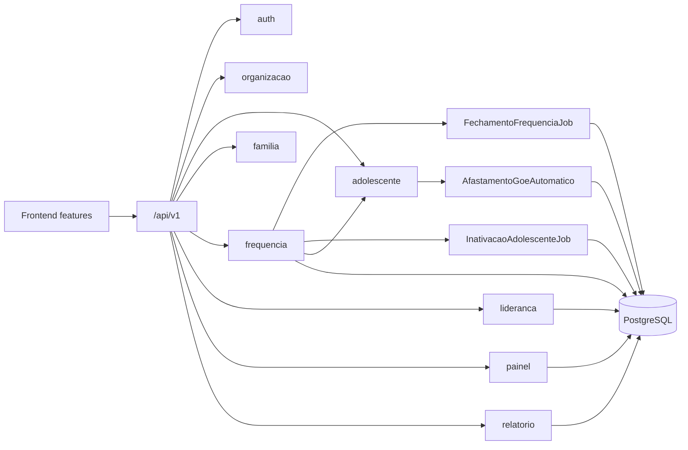

# Arquitetura

## Frontend

- React 18
- TypeScript
- Vite
- Material UI
- ECharts
- ESLint + Prettier + Vitest

## Backend

- Java 21
- Spring Boot 3
- Spring Security (JWT + refresh rotacionado)
- Spring Data JPA
- Hibernate
- Spotless, PMD, SpotBugs e JaCoCo

## Banco

- PostgreSQL
- Flyway (`backend/src/main/resources/db/migration/`)

## Relatórios

- HTML/CSS com impressão nativa do navegador (relatório de frequência por período)
- Exportação Excel (XLSX) para frequência e para chamada de liderança (`/relatorios/.../export`)
- JasperReports permanece no roadmap

## Infraestrutura

- Docker / Docker Compose (local: teto de memória no `backend` e no `postgres`; JVM com `MaxRAMPercentage=60` no Compose)
- Render (ver `docs/deploy-render.md`)
- Observabilidade: `traceId` em Problem Details e Actuator (ver `docs/observability.md`)

## CI/CD

- GitHub Actions
- Husky + lint-staged + commitlint (pre-commit e commit-msg)

## Estrutura Backend

Pacote-por-domínio em `br.com.sgd`:

- `adolescente`
- `audit`
- `auth`
- `common` (contratos compartilhados, como `PaginaResponse`)
- `config`
- `exception`
- `familia` (ficha 1:1 do adolescente)
- `frequencia` (encontros, chamada, prazo de lançamento, jobs de fechamento e inativação)
- `health`
- `lideranca` (`/chamadas-lideranca` — presença de discipuladores/co-líderes)
- `observability`
- `organizacao` (gerências, discipulados, co-líderes)
- `painel` (`/painel/lider`, `/painel/gerencia`, `/painel/admin`, `/painel/desempenho-discipulados`)
- `relatorio`
- `user`

Cada pacote de domínio concentra controller, service, repository e entidades relacionadas.

### Fluxos operacionais relevantes

- **Prazo de lançamento**: sexta-feira lançável até domingo 23:59:59 `America/Sao_Paulo` para líder/co-líder em discipulado padrão; admin ignora o prazo. Discipulados de formação não têm esse prazo.
- **Janela da chamada**: primeiro `PUT .../frequencias` grava `chamadaSalvaEm`; depois disso, líderes têm 3 horas; admin sempre pode.
- **Fechamento automático**: após o prazo, `FechamentoFrequenciaJob` (cron `0 20 3 * * *`, `America/Sao_Paulo`) marca sexta sem chamada de discipulado padrão como `NAO_REALIZADO` com justificativa padrão e `fechamentoAutomatico=true`. ADMIN pode reverter e preencher a chamada sem limpar o flag; só ADMIN exclui o encontro (`DELETE /encontros/{id}`). Formação não entra no job.
- **Inativação por ausência**: `InativacaoAdolescenteJob` (cron `0 15 3 * * *`, `America/Sao_Paulo`) aplica RN019 — `ativo=false` quando o cadastro tem mais de três meses e não há `PRESENTE` no período.
- **Afastamento GOE**: após salvar a chamada, `ChamadaService` avalia ausentes elegíveis (`AdolescenteService.afastarParaGoeSeElegivel`). Na subida, `AfastamentoGoeAutomatico` (`ApplicationRunner`) aplica o mesmo critério a quem já cumpre quatro faltas em seis semanas nos grupos regulares (RN043).
- **Anonimização LGPD**: `DELETE /adolescentes/{id}/dados-pessoais` (ADMIN) mascara dados pessoais e a ficha de família, preservando frequências (RN062 / UC013). O `PATCH` do adolescente não bloqueia por `anonimizado_em`.
- **Observação do encontro**: campo opcional atualizado via `PATCH /encontros/{id}` (não entra no `POST` de criação).
- **Chamada de liderança**: ADMIN salva presença parcial por discipulado regular (`PUT /chamadas-lideranca`); conflito de pessoa já lançada no dia exige `confirmarAtualizacao` (RN055–RN057). Formação fica fora da grade.
- **Desempenho dos discipulados**: `GET /painel/desempenho-discipulados` agrega presença mensal (encontros `REALIZADO`) e tamanho do grupo por vínculo vigente; só regulares; ADMIN global / GERENTE na gerência (RN061). Sem tabelas próprias — lê `encontros`, `frequencias` e `vinculos_adolescente_discipulado`.
- **Exclusão de gerência**: ADMIN pode `DELETE /gerencias/{id}` somente se não houver discipulados associados (RN060).

## Estrutura Frontend

Rotas autenticadas: `/app/{seção}` (`app/appNavigation.ts`). Mapa de menu por perfil: [06-wireframes.md](06-wireframes.md).

Organização por feature em `frontend/src`:

- `app/` — shell (`App`, `AuthenticatedApp`, `theme`, `main`, navegação)
- `shared/` — HTTP client, tipos, charts e UI (`DiscipuladoLiderancaInfo`, etc.)
- `features/` — módulos de domínio:
  - `auth`
  - `users`
  - `organizacao` (inclui `DiscipuladoPerformance` — aba Desempenho)
  - `adolescentes`
  - `familia`
  - `frequencia`
  - `lideranca` (`LeadershipAttendance`)
  - `dashboards` (visão executiva admin/gerência, líder, detalhe; gerência embute desempenho)
  - `relatorios`
- `test/` — setup do Vitest

Imports entre pastas usam o alias `@/*`.

### Dashboards

| Perfil | Componente principal | API |
| --- | --- | --- |
| ADMIN | `ExecutiveDashboard` (`escopo=admin`) + `AdminDashboard`; Estrutura → Desempenho | `GET /painel/admin`, `GET /painel/desempenho-discipulados` |
| GERENTE | `ExecutiveDashboard` (`escopo=gerencia`) + `ManagerDashboard` (inclui desempenho embutido) | `GET /painel/gerencia`, `GET /painel/desempenho-discipulados` |
| DISCIPULADOR / CO_LIDER | `LeaderDashboard` | `GET /painel/lider` |

Perfis acumulados recebem a união das visões; o painel “Meu discipulado” sempre usa a associação de liderança. Desempenho dos discipulados é exclusivo de ADMIN/GERENTE (RN061).
